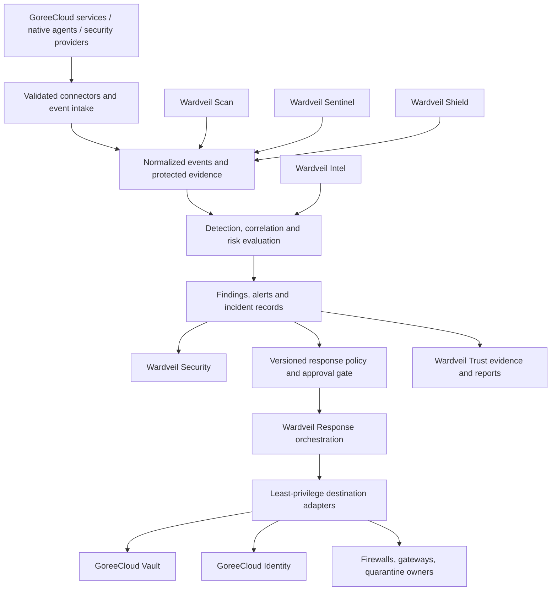

# Wardveil — Proposed Platform Architecture

| Field | Value |
| --- | --- |
| Document type | Technical architecture proposal |
| Owner | GoreeCloud |
| Status | Proposed; not an implemented-system description |
| Created / updated | 2026-10-25 |
| Canonical location | `GoreeCloud/wardveil/docs/architecture.md` |

## 1. Purpose and principles

Wardveil is GoreeCloud's proposed unified cybersecurity platform: **one security control plane, seven cohesive product modules, and replaceable integrations**. It is intended to monitor, assess, detect, investigate, and coordinate protective responses for GoreeCloud-operated services and eventually authorized external organizations.

Design principles:
- **Distinct ownership:** Wardveil owns security analysis and response orchestration. GoreeCloud Vault owns credentials, secrets, password management, secure sharing, and its Keycloak-related functions. GoreeCloud Identity owns authentication, identities, SSO, and its Authentik-related functions. Wardveil must never independently mutate those systems' authoritative records.
- **Defense in depth:** No one antivirus engine, indicator feed, IP list, or confidence score is conclusive.
- **Self-hosted and privacy-first:** Prefer local analysis; minimize telemetry, sensitive data movement, and reliance on third parties.
- **Provider neutrality:** Integrations are versioned adapters, not hard-coded infrastructure assumptions.
- **Safe automation:** Every security response is authorized, scoped, explainable, logged, reversible where possible, and bounded by explicit policy.
- **Tenant isolation:** If multi-organization support is implemented, enforce tenant isolation in collection, correlation, access, and response.
- **Truthful maturity:** No platform, engine, OS, API, or dashboard is claimed as operational until verified.

## 2. Product module responsibilities

| Module | Owns | Does not own |
| --- | --- | --- |
| **Wardveil Security** | Security command center, posture, alert and incident views, configuration and policy UI | Source-of-truth identity or secret storage |
| **Wardveil Scan** | File malware analysis, vulnerability findings, scanning jobs, quarantine requests and verdicts | Unilateral deletion of source files or bypass of a product's file-ownership controls |
| **Wardveil Shield** | Network and application defense policies, IP reputation enrichment, traffic mitigations | Authentication policy or unmanaged blanket blocking |
| **Wardveil Sentinel** | Endpoint, application, infrastructure, and network telemetry intake and detections | Direct authority over endpoint identity or unrelated device management |
| **Wardveil Intel** | Threat indicator ingestion, source provenance, enrichment, expiry, and confidence | Blind treatment of third-party indicators as confirmed compromise |
| **Wardveil Response** | Investigation-driven playbooks, approvals, dispatch, verification, reversal, and action audit | Direct execution outside destination-system authorization boundaries |
| **Wardveil Trust** | Evidence-backed security reporting, policy assessment, assurance and trust publication workflows | Unverified compliance claims or automatic certification |

## 3. Proposed layered design

The diagram is a **target architecture**, not proof of deployed components.

### A. Collection and analysis plane

- Support controlled **push events**, **polling connectors**, and **native OS-managed sensor services** when the target platform requires them.
- Validate inbound schema, signatures/authentication, timestamps, object scope, size limits, rate limits, and tenant context.
- Normalize provider output without discarding its original vendor verdict, rule ID, provenance, version, or timestamp.
- Correlate signals using asset identity, indicator context, time windows, and explicit rules; preserve evidence links for analyst review.
- Differentiate `event`, `finding`, `alert`, `incident`, and `action` as separate records.

### B. Policy and response plane

- Evaluate deterministic, versioned policies separately from detection.
- Default to **observe and alert**, not automatic blocking, quarantine, session revocation, or credential mutation.
- For authorized interventions, produce a narrowly scoped action request with target, reason, policy version, expiry, requester, and dry-run result.
- Route requests through authenticated product-owned APIs, with least-privilege credentials supplied via approved secret management; never copy Vault secrets into Wardveil's general event records.
- Persist execution state, idempotency key, rollback/expiry path, approval, and independent readback outcome.

### C. Product and presentation plane

- Present normalized alerts, attack timelines, case workspaces, provider health, scan verdicts, policy change history, and audit evidence.
- Follow **GoreeCloud UI (GC UI)** from `GoreeCloud/gc-ui` as the design and experience authority.
- Treat the web command center as supplementary. Any client offered on Linux, Windows, macOS, Android, iOS, or iPadOS must satisfy GoreeCloud's actual native-app acceptance criteria. Native sensors/daemons must respect their OS service lifecycle and permissions.

## 4. Proposed normalized data contracts

An `event` should contain:
- `event_id`, `schema_version`, `source`, `source_event_id`, `observed_at`, `ingested_at`
- `tenant_id` (when applicable), `asset_id`, `product_id`, `event_type`
- `severity`, `confidence`, `summary`, `indicator_refs`, `evidence_refs`
- `provider_name`, `provider_version`, `rule_id`, `deduplication_key`
- Redaction and retention labels; no unrestricted arbitrary secret-bearing payloads.

A `finding` adds verdict, supporting events, scoring rationale and status. An `incident` groups related findings with timeline, scope, assignee, containment status and resolution. A `response action` adds policy, requested action, resource scope, approval, execution receipt, readback, expiry and rollback metadata.

These are **design candidates**, not an approved production schema. Formalize them as versioned contracts before implementation.

## 5. Proposed external integration matrix

| Module | Candidate integration | Intended use | Review required |
| --- | --- | --- | --- |
| Scan | ClamAV | File scanning and signatures | Engine isolation; signature updates; archive/resource limits |
| Scan | YARA | Governed rule-based matching | Rule quality, sandboxing, false positives, provenance |
| Scan | Trivy | Vulnerability and dependency scanning | Supported targets, database freshness, CVE deduplication |
| Shield | CrowdSec | Detection decisions and remediation adapters | Bouncer placement, expiry, false positives |
| Shield | Cloudflare WAF | Edge rules and application protections | Tenant scoping, credentials, rollback and provider limits |
| Shield | OWASP Core Rule Set | Application attack heuristics | Policy tuning and maintenance |
| Sentinel | Wazuh | Endpoint event and file integrity monitoring | Agent enrollment, privilege, storage, compatibility |
| Sentinel | Suricata | Network detection | Sensor placement, traffic visibility, tuning |
| Intel | VirusTotal / AbuseIPDB / URLhaus / OTX / CrowdSec TI / CISA KEV | Reputation, indicators and exploited-vulnerability context | Provider terms, quotas, privacy, TTL, licensing |

Do not upload private files, raw internal URLs, credentials, or user data to external intelligence providers without explicit authorization and a documented lawful privacy basis. Prefer local hash lookups or private analysis where appropriate; even hashes and metadata can reveal sensitive information.

## 6. File scanning and quarantine flow (target)

1. A source product stores a new upload in a **private pending area** not accessible to normal consumers.
2. It sends an authenticated scan request containing a scoped reference, size, hash, media type and owner context.
3. Wardveil Scan obtains only authorized bytes, applies content, decompression, time, CPU and memory limits, and runs configured engines in isolated workers.
4. Wardveil Scan returns a signed/versioned verdict: `clean`, `malicious`, `suspicious`, `inconclusive` or `error`, including rule provenance and scan timestamp.
5. The **file-owning product**, under a configured policy, releases, holds, or quarantines the object. Fail-closed or fail-open behavior must be explicitly selected by risk class and tested.
6. Rescans and manual review may revise verdicts. Changes are audited, and release from quarantine requires appropriate authorization.

## 7. MVP architecture boundary

The first executable slice should be:
- Authenticated events API and persisted normalized event model.
- Single-organization assets and policy scopes, with a migration strategy for future tenants.
- Manual file-scan job lifecycle via an isolated ClamAV adapter.
- Incidents generated from scan verdicts, visible in a minimal GC UI-aligned command center.
- Alert-only policies and audit logging; **no destructive response automation**.
- Mock Vault and Identity adapter contracts (not production writes).

Do not split into microservices merely to mirror the seven product names. A modular backend with background workers is preferable until scale and isolation evidence justify deployment separation.

## 8. Interfaces and versioning

Specify authenticated, versioned internal interfaces for event ingestion, scan request/status, findings, incidents, policy evaluation, action proposals, and evidence retrieval. Use explicit authorization checks per resource and tenant. Prefer asynchronous queues for engine work and reliable retries, with bounded dead-letter handling. Define idempotency, ordering limits, schema compatibility, and retention before declaring APIs stable.

## 9. Open design decisions

- Approved language/runtime and deployment topology, based on existing GoreeCloud infrastructure rather than assumption.
- Single-user vs organization tenant model and entitlement boundaries.
- Evidence store, searchable-event retention, encryption and deletion policies.
- Policy authoring format, reviewer/approval roles, and emergency override safeguards.
- Scan-worker trust zones, safe engine signatures/rules update process, and offline behavior.
- Actual native OS targets and packaging/acceptance schedule.
- Provider licensing, API terms, rate limits and deployment constraints.

No implementation, production integration, or provider entitlement is represented as verified by this proposal.
